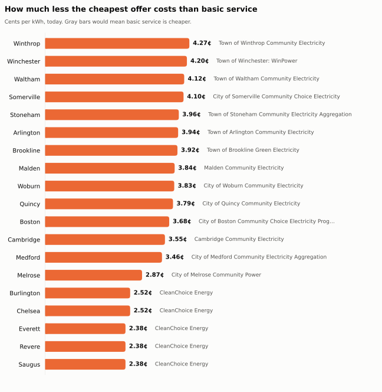

# Electricity Rate Tracker

Daily electricity supply rates from [EnergySwitch MA](https://energyswitchma.gov), comparing each city's utility basic service rate (National Grid or Eversource) with the cheapest supplier offer.

**Last updated:** November 23, 2026

## Today's savings

<picture>
  <source media="(prefers-color-scheme: dark)" srcset="charts/savings-dark.svg">
  
</picture>

| City | Utility | Basic service | Cheapest offer | Cheapest supplier | Savings | Cheapest non-town-program offer | Supplier | Savings |
|---|---|---:|---:|---|---:|---:|---|---:|
| Winthrop | National Grid | 17.185¢ | 12.910¢ | Town of Winthrop Community Electricity | 4.275¢ | 14.900¢ | CleanChoice Energy | 2.285¢ |
| Winchester | Eversource | 17.323¢ | 13.120¢ | Town of Winchester: WinPower | 4.203¢ | 14.800¢ | CleanChoice Energy | 2.523¢ |
| Waltham | Eversource | 17.323¢ | 13.200¢ | Town of Waltham Community Electricity | 4.123¢ | 14.800¢ | CleanChoice Energy | 2.523¢ |
| Somerville | Eversource | 17.323¢ | 13.220¢ | City of Somerville Community Choice Electricity | 4.103¢ | 14.800¢ | CleanChoice Energy | 2.523¢ |
| Stoneham | Eversource | 17.323¢ | 13.360¢ | Town of Stoneham Community Electricity Aggregation | 3.963¢ | 14.800¢ | CleanChoice Energy | 2.523¢ |
| Arlington | Eversource | 17.323¢ | 13.380¢ | Town of Arlington Community Electricity | 3.943¢ | 14.800¢ | CleanChoice Energy | 2.523¢ |
| Brookline | Eversource | 17.323¢ | 13.400¢ | Town of Brookline Green Electricity | 3.923¢ | 14.800¢ | CleanChoice Energy | 2.523¢ |
| Malden | National Grid | 17.185¢ | 13.345¢ | Malden Community Electricity | 3.840¢ | 14.900¢ | CleanChoice Energy | 2.285¢ |
| Woburn | Eversource | 17.323¢ | 13.495¢ | City of Woburn Community Electricity | 3.828¢ | 14.800¢ | CleanChoice Energy | 2.523¢ |
| Quincy | National Grid | 17.185¢ | 13.394¢ | City of Quincy Community Electricity | 3.791¢ | 14.900¢ | CleanChoice Energy | 2.285¢ |
| Boston | Eversource | 17.323¢ | 13.644¢ | City of Boston Community Choice Electricity Program | 3.679¢ | 14.800¢ | CleanChoice Energy | 2.523¢ |
| Cambridge | Eversource | 17.323¢ | 13.770¢ | Cambridge Community Electricity | 3.553¢ | 14.800¢ | CleanChoice Energy | 2.523¢ |
| Medford | National Grid | 17.185¢ | 13.720¢ | City of Medford Community Electricity Aggregation | 3.465¢ | 14.900¢ | CleanChoice Energy | 2.285¢ |
| Melrose | National Grid | 17.185¢ | 14.310¢ | City of Melrose Community Power | 2.875¢ | 14.900¢ | CleanChoice Energy | 2.285¢ |
| Burlington | Eversource | 17.323¢ | 14.800¢ | CleanChoice Energy | 2.523¢ | 14.800¢ | CleanChoice Energy | 2.523¢ |
| Chelsea | Eversource | 17.323¢ | 14.800¢ | CleanChoice Energy | 2.523¢ | 14.800¢ | CleanChoice Energy | 2.523¢ |
| Everett | National Grid | 17.185¢ | 14.900¢ | CleanChoice Energy | 2.285¢ | 14.900¢ | CleanChoice Energy | 2.285¢ |
| Revere | National Grid | 17.185¢ | 14.900¢ | CleanChoice Energy | 2.285¢ | 14.900¢ | CleanChoice Energy | 2.285¢ |
| Saugus | National Grid | 17.185¢ | 14.900¢ | CleanChoice Energy | 2.285¢ | 14.900¢ | CleanChoice Energy | 2.285¢ |

Rates are in cents per kWh. Savings is basic service minus the offer; a negative number would mean basic service is cheaper. The non-town-program columns leave out the town's own electricity program (municipal aggregation), showing the best deal from a regular supplier.

## Rate history

<picture>
  <source media="(prefers-color-scheme: dark)" srcset="charts/all-cities-dark.svg">
  
</picture>

Larger chart for one city: [Winthrop](charts/winthrop.svg) · [Winchester](charts/winchester.svg) · [Waltham](charts/waltham.svg) · [Somerville](charts/somerville.svg) · [Stoneham](charts/stoneham.svg) · [Arlington](charts/arlington.svg) · [Brookline](charts/brookline.svg) · [Malden](charts/malden.svg) · [Woburn](charts/woburn.svg) · [Quincy](charts/quincy.svg) · [Boston](charts/boston.svg) · [Cambridge](charts/cambridge.svg) · [Medford](charts/medford.svg) · [Melrose](charts/melrose.svg) · [Burlington](charts/burlington.svg) · [Chelsea](charts/chelsea.svg) · [Everett](charts/everett.svg) · [Revere](charts/revere.svg) · [Saugus](charts/saugus.svg)

## How this works

- `scrape.py` collects each city's offers every morning and adds them to `data/rates.csv`.
- `make_charts.py` rebuilds this README and the charts from that file.
- Basic service is the rate for the period that covers each day.
- The cheapest offer leaves out basic service. Cities are ordered by today's savings.

_This file is generated automatically. Edits made by hand will be overwritten._
