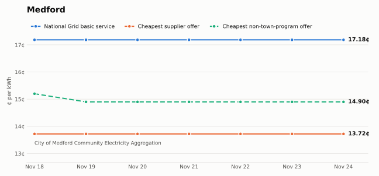
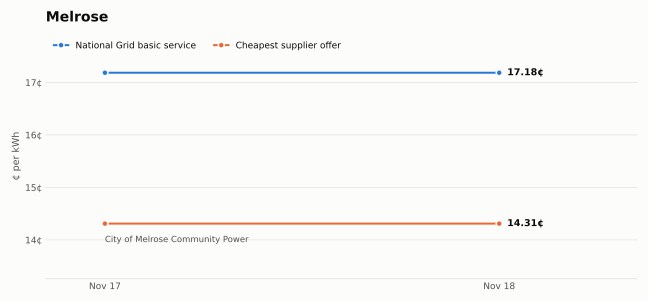
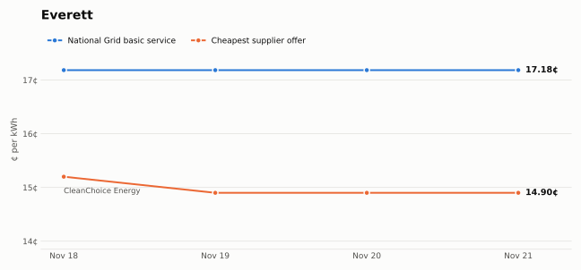
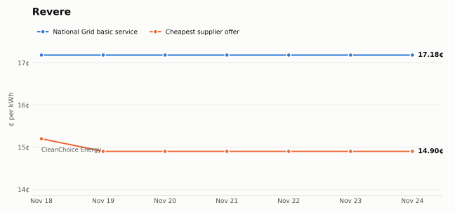
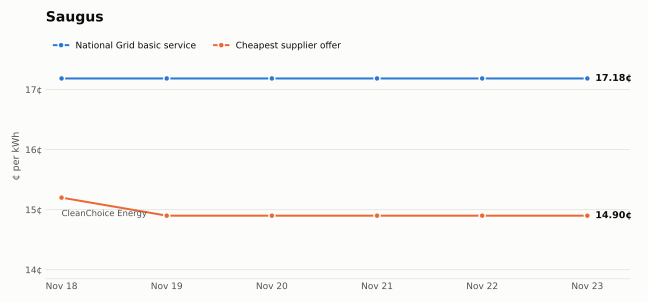

# Electricity Rate Tracker

Daily electricity supply rates from [EnergySwitch MA](https://energyswitchma.gov), comparing National Grid's basic service rate with the cheapest supplier offer in each city.

**Last updated:** November 18, 2026

## Today's rates

| City | Basic service | Cheapest offer | Cheapest supplier | Difference |
|---|---:|---:|---|---:|
| Malden | 17.185¢ | 13.345¢ | Malden Community Electricity | -3.840¢ |
| Medford | 17.185¢ | 13.720¢ | City of Medford Community Electricity Aggregation | -3.465¢ |
| Melrose | 17.185¢ | 14.310¢ | City of Melrose Community Power | -2.875¢ |
| Everett | 17.185¢ | 15.200¢ | CleanChoice Energy | -1.985¢ |
| Revere | 17.185¢ | 15.200¢ | CleanChoice Energy | -1.985¢ |
| Saugus | 17.185¢ | 15.200¢ | CleanChoice Energy | -1.985¢ |

Rates are in cents per kWh. A negative difference means the cheapest offer beats basic service.

## Rate history by city

### Malden

<picture>
  <source media="(prefers-color-scheme: dark)" srcset="charts/malden-dark.svg">
  
</picture>

### Medford

<picture>
  <source media="(prefers-color-scheme: dark)" srcset="charts/medford-dark.svg">
  
</picture>

### Melrose

<picture>
  <source media="(prefers-color-scheme: dark)" srcset="charts/melrose-dark.svg">
  
</picture>

### Everett

<picture>
  <source media="(prefers-color-scheme: dark)" srcset="charts/everett-dark.svg">
  
</picture>

### Revere

<picture>
  <source media="(prefers-color-scheme: dark)" srcset="charts/revere-dark.svg">
  
</picture>

### Saugus

<picture>
  <source media="(prefers-color-scheme: dark)" srcset="charts/saugus-dark.svg">
  
</picture>

## How this works

- `scrape.py` collects each city's offers every morning and adds them to `data/rates.csv`.
- `make_charts.py` rebuilds this README and the charts from that file.
- Basic service is the rate for the period that covers each day.
- The cheapest offer leaves out basic service and is labeled whenever the cheapest supplier changes.

_This file is generated automatically. Edits made by hand will be overwritten._
