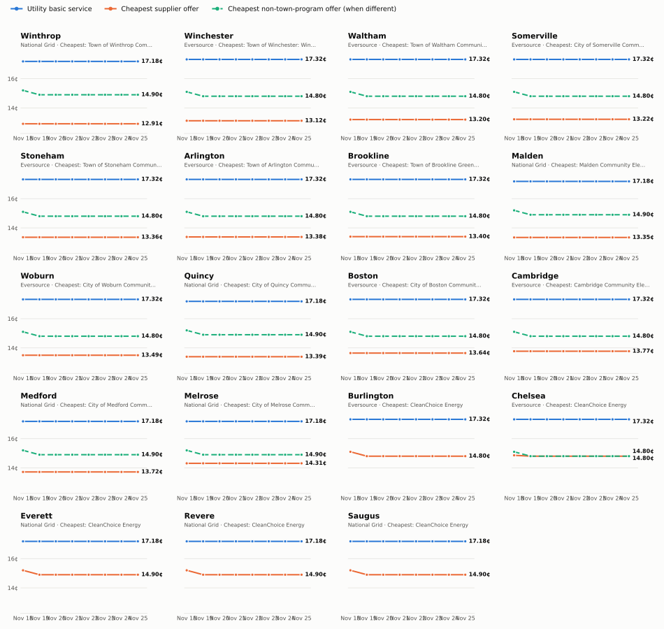

# Electricity Rate Tracker

Daily electricity supply rates from [EnergySwitch MA](https://energyswitchma.gov), comparing National Grid's basic service rate with the cheapest supplier offer in each city.

**Last updated:** November 18, 2026

## Today's savings

<picture>
  <source media="(prefers-color-scheme: dark)" srcset="charts/savings-dark.svg">
  
</picture>

| City | Basic service | Cheapest offer | Cheapest supplier | Savings |
|---|---:|---:|---|---:|
| Malden | 17.185¢ | 13.345¢ | Malden Community Electricity | 3.840¢ |
| Medford | 17.185¢ | 13.720¢ | City of Medford Community Electricity Aggregation | 3.465¢ |
| Melrose | 17.185¢ | 14.310¢ | City of Melrose Community Power | 2.875¢ |
| Everett | 17.185¢ | 15.200¢ | CleanChoice Energy | 1.985¢ |
| Revere | 17.185¢ | 15.200¢ | CleanChoice Energy | 1.985¢ |
| Saugus | 17.185¢ | 15.200¢ | CleanChoice Energy | 1.985¢ |

Rates are in cents per kWh. Savings is basic service minus the cheapest offer; a negative number would mean basic service is cheaper.

## Rate history

<picture>
  <source media="(prefers-color-scheme: dark)" srcset="charts/all-cities-dark.svg">
  
</picture>

Larger chart for one city: [Malden](charts/malden.svg) · [Medford](charts/medford.svg) · [Melrose](charts/melrose.svg) · [Everett](charts/everett.svg) · [Revere](charts/revere.svg) · [Saugus](charts/saugus.svg)

## How this works

- `scrape.py` collects each city's offers every morning and adds them to `data/rates.csv`.
- `make_charts.py` rebuilds this README and the charts from that file.
- Basic service is the rate for the period that covers each day.
- The cheapest offer leaves out basic service. Cities are ordered by today's savings.

_This file is generated automatically. Edits made by hand will be overwritten._
